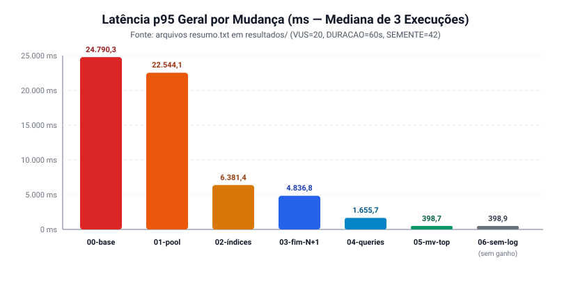
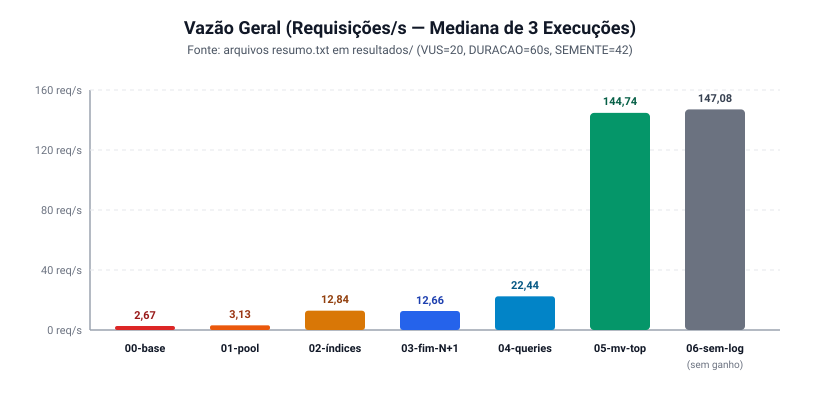

# Leituras sequenciais e consultas repetitivas saturavam o banco: como reduzimos o p95 de 24.790,3 ms para 398,9 ms e multiplicamos a vazão de 2,67 para 147,08 req/s sem adicionar hardware

## 1. Resumo

A API da loja fictícia apresentava alta latência e baixa vazão sob carga de 20 usuários simultâneos: na [linha de base](../experimentos.md#00--linha-de-base), a mediana das 3 execuções foi de 2,67 requisições por segundo, com p95 de 24.790,3 ms e a CPU do PostgreSQL saturada em 97,3%. O diagnóstico revelou ausência de índices secundários, abertura de conexão a cada consulta, consultas N+1 e agregações pesadas feitas a cada chamada. Após [seis mudanças incrementais](../experimentos.md#resumo), com os mesmos limites de CPU e memória, a vazão chegou a 147,08 req/s e o p95 caiu para 398,9 ms.

## 2. Contexto e diagnóstico

A aplicação consiste em uma API Node.js 20 (Express e `pg`) e um banco PostgreSQL 16 em containers Docker, populado com 100 mil clientes, 20 mil produtos, 500 mil pedidos e 1,5 milhão de itens de pedido. Nas três baterias da linha de base ([`00-linha-de-base`](../experimentos.md#00--linha-de-base)), o container `banco` operou no teto de 97,3% de CPU média (404,7 MiB de memória), enquanto a `api` consumiu apenas 6,3% de CPU (75,2 MiB de memória), indicando que o gargalo residia no banco e na forma como a API o consultava.

A coleta de estatísticas do catálogo ([`diagnostico/01-tabelas-e-indices.txt`](../diagnostico/01-tabelas-e-indices.txt)) e dos planos `EXPLAIN (ANALYZE, BUFFERS)` ([`diagnostico/02-explain-consultas.txt`](../diagnostico/02-explain-consultas.txt)) comprovou cinco problemas principais:
1. **Falta de índices secundários:** existiam apenas os quatro índices de chave primária. A tabela `itens_pedido` acumulou 1.823 leituras sequenciais completas (*Sequential Scans*, 1,314 bilhão de linhas lidas) e zero leituras por índice; na página 1.000 de `/pedidos`, a ordenação despejava 32.632 kB por processo em disco (`external merge Disk`), somando 101 arquivos temporários (2.008 MB).
2. **Conexão nova por consulta:** `api/src/db.js` abria e fechava um `new Client()` a cada query. O teste isolado ([`diagnostico/03-custo-conexao.txt`](../diagnostico/03-custo-conexao.txt)) mediu mediana de 6,361 ms por `SELECT 1` com conexão nova contra 0,199 ms reutilizando conexão.
3. **Consultas N+1 em `/clientes/:id/pedidos`:** para cada cliente (média de 5 pedidos e 15 itens), a rota disparava em média 22 consultas sequenciais (máximo de 32).
4. **Filtro não indexável e agregação na aplicação:** `/relatorios/vendas-por-dia` filtrava por `p.criado_em::date BETWEEN $1 AND $2` e transferia 12.945 linhas (com 3.468 kB só da coluna `observacoes`) para o Node.js agrupar; `/relatorios/top-produtos` agregava 1,35 milhão de itens a cada chamada (1.429,7 ms mesmo com o banco ocioso).
5. **Log síncrono do corpo da resposta:** `api/src/server.js` serializava e imprimia o corpo inteiro de cada resposta via `console.log` (média de 1.160 bytes por linha em [`diagnostico/04-volume-de-log.txt`](../diagnostico/04-volume-de-log.txt)).

Hipótese de causa: a saturação de CPU do banco e o p95 de 24.790,3 ms decorrem da combinação de varreduras sequenciais por falta de índices, multiplicação de idas ao banco (conexão por query e loop N+1) e recálculo repetitivo de agregações em centenas de milhares de linhas.

## 3. Estado da arte

### Reutilização de conexões (Connection Pooling)
O PostgreSQL implementa o modelo cliente/servidor de um processo por conexão (*"process per user"*): cada nova conexão aceita pelo processo supervisor (`postmaster`) cria um processo backend dedicado no servidor [2]. Na camada de aplicação Node.js, a documentação oficial do `node-postgres` destaca que abrir um cliente novo exige um handshake que leva de 20 a 30 ms e recomenda o uso de `pg.Pool` para manter conexões abertas e reutilizáveis [1].

### Indexação B-Tree, expressões, ordenação e trigramas GIN
Segundo a documentação do PostgreSQL 16, índices evitam leituras sequenciais da tabela inteira, mas adicionam custo em operações de escrita, devendo ser criados conforme os filtros reais de leitura [3]. Quando a cláusula `WHERE` aplica uma função como `lower(email)`, um índice simples na coluna não é usado; é necessário um índice sobre expressão (`CREATE INDEX ... ON tabela (lower(coluna))`) [4]. Para consultas com `ORDER BY ... LIMIT n`, um índice que corresponda à ordenação permite recuperar as primeiras $n$ linhas diretamente, sem ordenar todo o conjunto em memória ou em arquivos temporários de disco limitados por `work_mem` [5, 10]. Já buscas por substring com curinga inicial (`ILIKE '%termo%'`) não são atendidas por árvores B-Tree tradicionais, mas a extensão oficial `pg_trgm` extrai trigramas de 3 caracteres e permite indexar operadores `LIKE` e `ILIKE` com índices GIN (`gin_trgm_ops`) [6].

### Reescrita de consultas, predicados SARGable e pré-agregação
Markus Winand demonstra que aplicar conversão ou truncamento de data sobre a coluna filtrada (como `criado_em::date`) ofusca a coluna e impede o uso de um índice B-Tree no timestamp original; a solução recomendada é reescrever o predicado como um intervalo fechado no início e aberto no fim sobre a coluna pura (`criado_em >= inicio AND criado_em < fim + 1 dia`) [9]. Em paginações profundas, tanto a documentação do PostgreSQL quanto Winand ressaltam que as linhas saltadas por `OFFSET` continuam sendo lidas e computadas no servidor [7, 8]. Para relatórios analíticos pesados cuja base não exige recálculo instantâneo a cada leitura, o PostgreSQL oferece *Materialized Views*, que persistem o resultado pré-agregado em formato de tabela física indexável [11]. Por fim, a documentação de performance do Express recomenda evitar `console.log()` em produção por ser síncrono quando o destino é terminal ou arquivo [12].

## 4. Alternativas consideradas

As estimativas de custo, risco e esforço são qualitativas. Medimos o desempenho da alternativa C na bateria do desafio.

| Alternativa | Custo | Desempenho | Risco | Esforço |
|---|---|---|---|---|
| **[A] Escalonamento vertical (aumentar CPU e RAM dos containers)** | Maior (requer mais capacidade de CPU e memória) | Moderado (alivia fila de CPU, mas mantém complexidade $O(N)$ nas varreduras) | Baixo (sem alteração de código ou esquema) | Mínimo (alterar limites no `docker-compose.yml`) |
| **[B] Cache externo na camada de aplicação (ex.: container Redis)** | Médio (novo serviço consumindo memória e rede) | Alto em leituras repetidas (*cache hit*), nulo em chaves frias (*cache miss*) | Médio (invalidação de cache e risco de servir dados desatualizados) | Médio (provisionar serviço e serializar respostas por rota) |
| **[C] Otimização na origem (Pool de conexões + Índices B-Tree/GIN + Reescrita SQL + Materialized View)** | Mesmos limites de CPU e RAM, com espaço em disco para índices e dados pré-agregados | Melhora geral de latência e vazão na carga medida | Baixo (validado pelas 42 respostas do verificador de contrato) | Médio (diagnóstico de planos `EXPLAIN` e refatoração das consultas) |

A Alternativa A trata o sintoma pagando mais caro por hardware para executar trabalho desnecessário (ler 1,5 milhão de linhas para buscar 2 itens de um pedido). A Alternativa B adiciona complexidade operacional e consumo de memória de um terceiro container sem corrigir a lentidão das consultas quando a chave não está em cache (num universo de 100 mil clientes). A Alternativa C elimina o trabalho supérfluo diretamente na comunicação entre API e PostgreSQL sem elevar os limites dos containers.

## 5. Solução escolhida e por quê

Escolhemos a **Alternativa C (otimização na origem, em etapas isoladas)** porque o diagnóstico mostrou varreduras extensas, muitas idas ao banco e agregações repetidas. Os índices reduziram o trabalho das consultas, e o PostgreSQL passou a servir o ranking de produtos pré-agregado em uma view materializada [11].

Manter os mesmos limites de CPU e memória permitiu atender mais requisições com a capacidade disponível. Aumentar esses limites deixaria as varreduras e consultas repetidas em operação. Um cache externo exigiria um serviço adicional e uma política de invalidação, e as consultas ainda seriam executadas quando a chave estivesse ausente do cache.

## 6. Experimento e resultado

| Mudança | Hipótese | p95 antes → depois | req/s antes → depois | CPU/memória | Pastas de resultados | Conclusão |
|---|---|---|---|---|---|---|
| [`01-pool-conexoes`](../experimentos.md#01--pool-de-conex%C3%B5es) | Trocar `new Client()` a cada consulta por `pg.Pool` deve reduzir o p95 e subir req/s ao eliminar o handshake por query [1, 2]. | 24790.3 ms → 22544.1 ms | 2.67 → 3.13 | Banco: 97.3% → 98.4% CPU, 404.7 → 405.4 MiB API: 6.3% → 5.8% CPU, 75.2 → 32.5 MiB | Antes: [`00-linha-de-base`](../experimentos.md#00--linha-de-base) Depois: [`01-pool-conexoes`](../experimentos.md#01--pool-de-conex%C3%B5es) | **Aplicada e medida:** ganho modesto; a CPU do banco seguiu saturada pelas leituras sequenciais. |
| [`02-indices-banco`](../experimentos.md#02--%C3%ADndices-secund%C3%A1rios-e-de-trigramas-no-banco) | Criar índices B-Tree (compostos, funcionais e `INCLUDE`) e GIN `pg_trgm` deve derrubar o p95 e multiplicar req/s ao substituir *Seq Scans* por *Index Scans* [3, 4, 5, 6]. | 22544.1 ms → 6381.4 ms | 3.13 → 12.84 | Banco: 98.4% → 97.6% CPU, 405.4 → 415.3 MiB API: 5.8% → 15.6% CPU, 32.5 → 87.0 MiB | Antes: [`01-pool-conexoes`](../experimentos.md#01--pool-de-conex%C3%B5es) Depois: [`02-indices-banco`](../experimentos.md#02--%C3%ADndices-secund%C3%A1rios-e-de-trigramas-no-banco) | **Aplicada e medida:** vazão quadruplicou e mediana geral caiu de 1603.5 para 302.5 ms. |
| [`03-eliminar-n-mais-1`](../experimentos.md#03--elimina%C3%A7%C3%A3o-de-consultas-n1-em-get-clientesidpedidos) | Substituir o loop N+1 em `/clientes/:id/pedidos` por busca única de itens com `JOIN produtos` deve reduzir o p95 da rota e o p95 geral. A hipótese partiu do [diagnóstico local](../diagnostico/README.md). | 6381.4 ms → 4836.8 ms | 12.84 → 12.66 | Banco: 97.6% → 96.7% CPU, 415.3 → 417.0 MiB API: 15.6% → 15.6% CPU, 87.0 → 41.4 MiB | Antes: [`02-indices-banco`](../experimentos.md#02--%C3%ADndices-secund%C3%A1rios-e-de-trigramas-no-banco) Depois: [`03-eliminar-n-mais-1`](../experimentos.md#03--elimina%C3%A7%C3%A3o-de-consultas-n1-em-get-clientesidpedidos) | **Aplicada e medida:** mediana da rota caiu de 2794.5 para 1316.4 ms e p95 geral caiu para 4836.8 ms. |
| [`04-otimizar-queries`](../experimentos.md#04--proje%C3%A7%C3%A3o-de-colunas-e-agrega%C3%A7%C3%A3o-sql-em-vendas-por-dia) | Usar filtro de data SARGable e `GROUP BY` no SQL em `vendas-por-dia` e remover `SELECT *` deve reduzir o p95 e a CPU da API [5, 9]. | 4836.8 ms → 1655.7 ms | 12.66 → 22.44 | Banco: 96.7% → 99.7% CPU, 417.0 → 445.4 MiB API: 15.6% → 4.1% CPU, 41.4 → 27.2 MiB | Antes: [`03-eliminar-n-mais-1`](../experimentos.md#03--elimina%C3%A7%C3%A3o-de-consultas-n1-em-get-clientesidpedidos) Depois: [`04-otimizar-queries`](../experimentos.md#04--proje%C3%A7%C3%A3o-de-colunas-e-agrega%C3%A7%C3%A3o-sql-em-vendas-por-dia) | **Aplicada e medida:** vazão subiu para 22.44 req/s, p95 caiu para 1655.7 ms e CPU da API caiu para 4.1%. |
| [`05-mv-top-produtos`](../experimentos.md#05--materialized-view-mv_top_produtos-para-get-relatoriostop-produtos) | Pré-agregar a receita por produto em uma *Materialized View* indexada deve eliminar a leitura de 1,35M itens em `top-produtos` [11]. | 1655.7 ms → 398.7 ms | 22.44 → 144.74 | Banco: 99.7% → 97.9% CPU, 445.4 → 347.6 MiB API: 4.1% → 13.4% CPU, 27.2 → 29.5 MiB | Antes: [`04-otimizar-queries`](../experimentos.md#04--proje%C3%A7%C3%A3o-de-colunas-e-agrega%C3%A7%C3%A3o-sql-em-vendas-por-dia) Depois: [`05-mv-top-produtos`](../experimentos.md#05--materialized-view-mv_top_produtos-para-get-relatoriostop-produtos) | **Aplicada e medida:** vazão saltou para 144.74 req/s, p95 caiu para 398.7 ms e p99 caiu de 12045.5 para 504.1 ms. |
| [`06-remover-log-resposta`](../experimentos.md#06--remo%C3%A7%C3%A3o-do-log-do-corpo-da-resposta-em-apisrcserverjs) | Remover o `console.log` do corpo da resposta em `server.js` deve reduzir a CPU da API e elevar req/s [12]. | 398.7 ms → 398.9 ms | 144.74 → 147.08 | Banco: 97.9% → 97.8% CPU, 347.6 → 186.0 MiB API: 13.4% → 12.6% CPU, 29.5 → 30.0 MiB | Antes: [`05-mv-top-produtos`](../experimentos.md#05--materialized-view-mv_top_produtos-para-get-relatoriostop-produtos) Depois: [`06-remover-log-resposta`](../experimentos.md#06--remo%C3%A7%C3%A3o-do-log-do-corpo-da-resposta-em-apisrcserverjs) | **Aplicada, sem ganho:** variação dentro do ruído; a API já tinha folga de CPU e o gargalo seguiu no banco. A memória média do banco caiu entre as etapas, e a causa dessa variação ficou em aberto. |

A sequência de experimentos mostra como um gargalo encobre o seguinte: o pool de conexões (`01`) teve efeito limitado enquanto faltavam índices; os índices (`02`) quadruplicaram a vazão, mas expuseram o custo do N+1 e dos relatórios; eliminar o N+1 (`03`) e empurrar a agregação de `vendas-por-dia` para o SQL (`04`) baixaram o p95 para 1.655,7 ms, deixando `top-produtos` como o grande ofensor; e a materialização de `top-produtos` (`05`) destravou o banco, elevando a vazão para 144,74 req/s. Na etapa `06`, a remoção do log teve efeito limitado na carga medida. O PostgreSQL continuou perto do limite de CPU.

## 7. Limites e testes futuros

Nossa solução possui três limites importantes que precisam ser considerados em produção:
1. **Defasagem da *Materialized View* sob escrita:** como o desafio avalia apenas rotas de leitura sobre dados estáticos, `mv_top_produtos` não precisou ser recarregada. Em um sistema com novos pedidos entrando a todo instante, a view ficaria desatualizada até a execução de `REFRESH MATERIALIZED VIEW CONCURRENTLY mv_top_produtos` [11]. **O que mudaria nossa conclusão:** se o negócio exigisse ranking de receita atualizado em tempo real estrito (defasagem zero) sob alta taxa de escrita, descartaríamos a *Materialized View* em favor de uma tabela de resumo mantida incrementalmente ou cache com invalidação.
2. **Custo de `OFFSET` e `COUNT(*)` em `/pedidos`:** mesmo com *Index-Only Scan*, a rota `/pedidos` ainda computa `SELECT count(*)` e descarta até 19.980 linhas no `OFFSET` da página 1.000 [7, 8]. O custo desse trabalho torna a rota uma candidata a diagnóstico. A bateria mediu CPU por container, e a contribuição de cada rota ficou em aberto.
3. **O que ficou para teste futuro:** detalhamos em [`proximos-testes.md`](../proximos-testes.md) três experimentos futuros: (a) paginação por cursor (*Keyset Pagination* / *No Offset*) caso o contrato de `/pedidos` possa evoluir [7, 8]; (b) teste de carga mista com `REFRESH MATERIALIZED VIEW CONCURRENTLY` [11]; e (c) ajuste fino de `work_mem` e `shared_buffers` para períodos analíticos longos [10].

## 8. Referências

1. node-postgres. *Pooling*. Disponível em: https://node-postgres.com/features/pooling. Data de acesso: 10 nov. 2026.
2. PostgreSQL Global Development Group. *PostgreSQL 16 Documentation — 52.2. How Connections Are Established*. Disponível em: https://www.postgresql.org/docs/16/connect-estab.html. Data de acesso: 10 nov. 2026.
3. PostgreSQL Global Development Group. *PostgreSQL 16 Documentation — 11.1. Indexes: Introduction*. Disponível em: https://www.postgresql.org/docs/16/indexes-intro.html. Data de acesso: 10 nov. 2026.
4. PostgreSQL Global Development Group. *PostgreSQL 16 Documentation — 11.7. Indexes on Expressions*. Disponível em: https://www.postgresql.org/docs/16/indexes-expressional.html. Data de acesso: 10 nov. 2026.
5. PostgreSQL Global Development Group. *PostgreSQL 16 Documentation — 11.4. Indexes and ORDER BY*. Disponível em: https://www.postgresql.org/docs/16/indexes-ordering.html. Data de acesso: 10 nov. 2026.
6. PostgreSQL Global Development Group. *PostgreSQL 16 Documentation — F.35. pg_trgm — Support for similarity of text using trigram matching*. Disponível em: https://www.postgresql.org/docs/16/pgtrgm.html. Data de acesso: 10 nov. 2026.
7. PostgreSQL Global Development Group. *PostgreSQL 16 Documentation — 7.6. LIMIT and OFFSET*. Disponível em: https://www.postgresql.org/docs/16/queries-limit.html. Data de acesso: 10 nov. 2026.
8. Winand, Markus. *Use The Index, Luke — No Offset: Keyset Pagination*. Disponível em: https://use-the-index-luke.com/no-offset. Data de acesso: 10 nov. 2026.
9. Winand, Markus. *Use The Index, Luke — Obfuscated Conditions: Dates*. Disponível em: https://use-the-index-luke.com/sql/where-clause/obfuscation/dates. Data de acesso: 10 nov. 2026.
10. PostgreSQL Global Development Group. *PostgreSQL 16 Documentation — 20.4. Resource Consumption (work_mem)*. Disponível em: https://www.postgresql.org/docs/16/runtime-config-resource.html. Data de acesso: 10 nov. 2026.
11. PostgreSQL Global Development Group. *PostgreSQL 16 Documentation — 41.3. Materialized Views*. Disponível em: https://www.postgresql.org/docs/16/rules-materializedviews.html. Data de acesso: 10 nov. 2026.
12. Express / OpenJS Foundation. *Performance Best Practices: Using Express in Production (Do logging correctly)*. Disponível em: https://expressjs.com/en/advanced/best-practice-performance/. Data de acesso: 10 nov. 2026.

## 9. Uso de IA

Utilizamos agentes de IA (Antigravity) como apoio na escrita dos scripts de diagnóstico em `diagnostico/`, na implementação incremental das otimizações em código/SQL e na estruturação inicial dos documentos em Markdown. Todas as fontes sugeridas foram abertas e validadas manualmente pelo autor antes de serem aceitas, e todos os números de desempenho e diagnóstico foram conferidos diretamente contra os arquivos brutos gerados por `scripts/medir.sh` em `resultados/` e pelo verificador `scripts/verificar-contrato.sh`.
